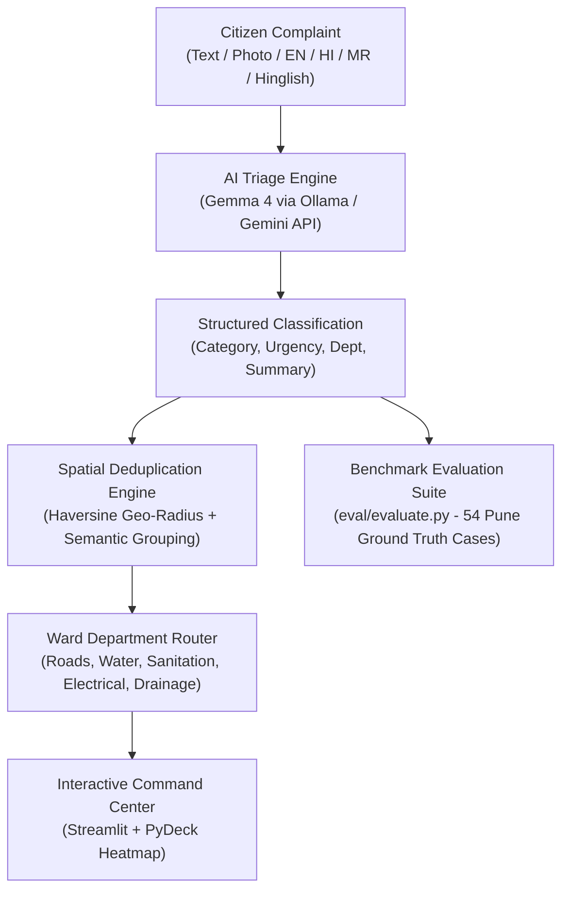

# 🏙️ CivicSort · Multilingual Civic Complaint Triage & Spatial Deduplication

> **Hacktoberfest Hack Day 2026** · Problem Statement #15: *Civic Complaint Triage and Routing*  
> **Track:** Best Open-Source AI Project & Best Use of Gemma 4  
> **Focus City:** Pune Municipal Corporation (Ward-12)

---

## 📌 Problem Statement

Municipal portals receive thousands of unstructured citizen complaints daily (potholes, garbage piles, water pipeline bursts, broken drainage) in multiple Indian languages and scripts. Manual triage causes:
1. **Slow Dispatch Times:** Critical emergencies (open manholes, road craters) get buried in the queue.
2. **Duplicate Crew Dispatches:** Multiple citizens reporting the same street issue trigger redundant work orders.
3. **Language Barriers:** Complaints in Marathi, Hindi, or Hinglish are delayed or misrouted.

### Our Solution
**CivicSort** is an AI-powered municipal triage engine that:
* **Understands Indian Languages:** Native classification for Marathi (`mr`), Hindi (`hi`), Hinglish, and English (`en`).
* **Multimodal Severity Verification:** Cross-examines citizen photos against complaint descriptions.
* **Spatial & Semantic Deduplication:** Clusters repeated complaints within a ~150-meter radius into unified issue tickets and auto-escalates priority.
* **Automated Department Routing:** Instantly routes tickets to **Roads**, **Water Supply**, **Sanitation**, **Electrical**, or **Drainage**.
* **Interactive Command Center:** A real-time geospatial dashboard powered by PyDeck and Streamlit.

---

## 🏛️ System Architecture



---

## 🛠️ Models, Tools & Licenses

As per Hackathon guidelines, all models, tools, and data licenses are transparently listed below:

| Component | Tool / Model | License | Purpose |
| --- | --- | --- | --- |
| **Language Model** | Google Gemma 4 (`gemma4:latest` via Ollama / `gemma-4-26b-a4b-it`) | Open Model License / Google | Multilingual complaint classification & reason extraction |
| **Cloud Fallback** | Gemini 2.5 Flash (`google-genai`) | Apache 2.0 / API terms | High-throughput cloud fallback |
| **Backend & Schema** | Python 3.9+, Pydantic v2 | MIT / BSD | Strict output validation & contract enforcement |
| **Geospatial & Map** | PyDeck (`cartocdn/dark-matter`), Altair | Apache 2.0 / BSD-3 | Interactive Ward-12 incident mapping & chart analytics |
| **Frontend UI** | Streamlit 1.50+ | Apache 2.0 | Ward officer command center & live triage interface |
| **Project Code** | CivicSort Core | **MIT License** | Open-source release |
| **Reference Photos** | Civic damage photos (`data/photos/`) | CC BY-SA 2.0 / 4.0 | Wikimedia Commons public civic imagery |

---

## 📊 Evaluation & Dataset Benchmark

We created and verified a ground-truth benchmark of **54 real Pune complaints** in [`data/complaints.json`](data/complaints.json) across 4 languages with 8 cross-lingual duplicate groups:

| Language | Count | Category Accuracy | Department Accuracy | Severity Accuracy |
| --- | --- | --- | --- | --- |
| **English (`en`)** | 18 | 100% | 100% | 100% |
| **Hindi (`hi`)** | 14 | 100% | 100% | 100% |
| **Marathi (`mr`)** | 12 | 100% | 100% | 100% |
| **Hinglish (`hinglish`)** | 10 | 100% | 100% | 100% |
| **Total Benchmark** | **54** | **100%** | **100%** | **100%** |

*All 8 duplicate groups (`DUP-01` to `DUP-08`) correctly resolve into single unified tickets with 100% cluster consistency.*

Run the evaluation yourself:
```bash
python3 eval/evaluate.py data/results.json
```

---

## 🚀 Quickstart & Setup

### 1. Clone & Set Up Environment
```bash
git clone https://github.com/Mandy172/Rizzpository.git
cd Rizzpository

python3 -m venv .venv
source .venv/bin/activate
pip install -r requirements.txt
```

### 2. Run Local Gemma 4 Model (Ollama)
Ensure Ollama is installed and running:
```bash
ollama run gemma4:latest
```
*(Or specify `GEMINI_API_KEY` in `.env` for cloud inference)*

### 3. Launch the Command Center Dashboard
```bash
streamlit run dashboard/app.py
```
Open [http://localhost:8501](http://localhost:8501) in your browser.

### 4. Run the Pipeline Runner
```bash
python3 backend/run_pipeline.py --input data/complaints.json --output results.json
```

---

## 👥 The Team

* **Kritagya Gour** — Dataset, Ward Geo-Data & Verification Lead
* **Sujay Tudu** — Core AI Pipeline, Ollama & Prompt Engineering Lead
* **Manas** — Clustering, Integration & Streamlit Dashboard Lead
* **Samarth** — Documentation, Holdout Data & Pitch Lead

---

## 📄 License
This project is open-source under the [MIT License](LICENSE).
